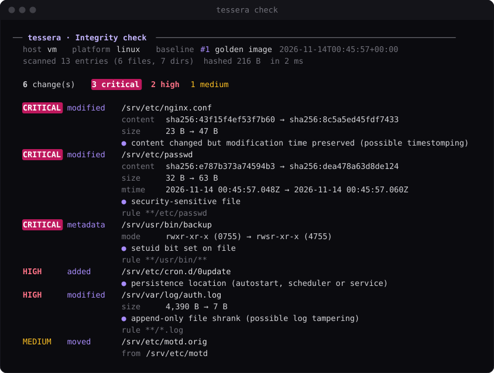
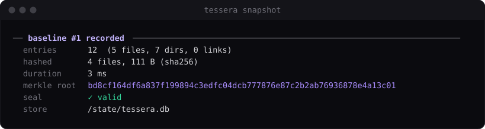
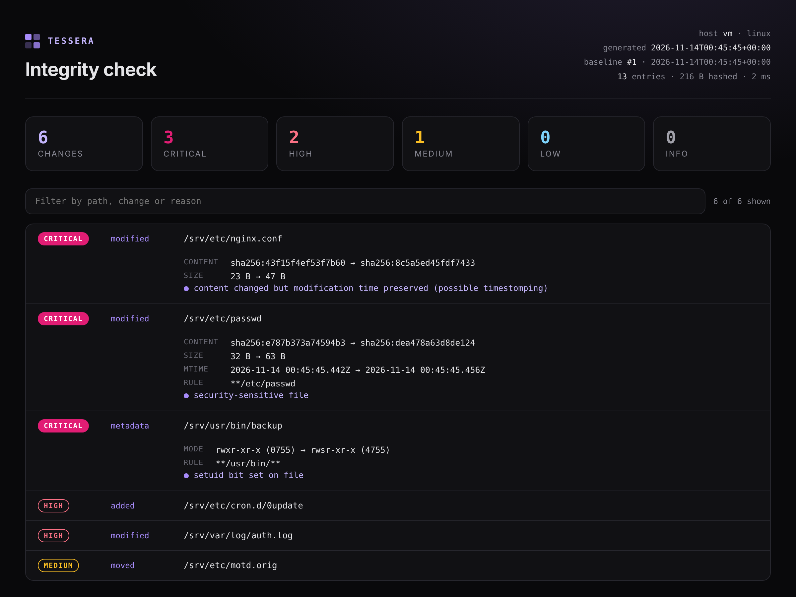

<div align="center">

# ▚ Tessera

**Tamper-evident filesystem integrity monitoring for Linux, macOS and Windows.**

Know exactly what changed on your systems, and prove your baseline was never quietly rewritten.

[](https://github.com/jullewz/tessera/actions/workflows/ci.yml)


[](LICENSE)



</div>

---

## What Tessera does

Tessera records a trusted **baseline** of the files you care about (hashes, permissions, owners, timestamps, link targets, platform attributes). Later it scans again and tells you what changed, how serious it is, and why.

Classic tools like Tripwire and AIDE do the first part. Tessera adds three things they lack:

1. **Cryptographic tamper evidence.** Every baseline is hashed into an [RFC 6962](https://www.rfc-editor.org/rfc/rfc6962) Merkle tree and sealed with HMAC-SHA256. An intruder who edits the baseline database to hide their tracks breaks the seal, and `tessera check` exits with code `3`.
2. **Attack-aware severity.** Heuristics recognise what intruders do: new setuid binaries, loosened permissions, cron and autostart persistence, log truncation, and **timestomping** (content changed while the modification time was reset).
3. **Portable proofs.** Export a signed manifest, or prove that one single file belonged to a baseline with a logarithmic-size inclusion proof, without sharing the rest of the baseline.

It is a single pure-Python package with **zero runtime dependencies**. It installs anywhere Python 3.11+ runs.

## Features

| Area | What you get |
|---|---|
| **Scanning** | Parallel streaming hashes (SHA-256, SHA-512, BLAKE2b, SHA3-256), `lstat`-based metadata, symlink loop protection, mount boundary detection, Windows junction handling, size limits |
| **Policy** | Glob rules with `**` and `{a,b}`, last-match-wins like `.gitignore`, built-in profiles (`full`, `content`, `permissions`, `append`, `existence`, `paranoid`, `ignore`) plus custom profiles |
| **Detection** | Added, removed, modified, metadata, type change, **moved** (by content hash), unreadable |
| **Risk heuristics** | setuid/setgid, world-writable, new executables in system dirs, root ownership changes, persistence locations on all three platforms, Windows hidden/system attributes, timestomping, symlink retargeting, log truncation |
| **Tamper evidence** | Merkle root per baseline, HMAC seals, signed JSON manifests, per-file inclusion proofs |
| **Reports** | Colour terminal, JSON, Markdown, self-contained HTML, SARIF 2.1.0 (GitHub code scanning) |
| **Automation** | Watch mode with de-duplicated alerts, command hooks (JSON on stdin, no shell), webhooks, CI-friendly exit codes |
| **Storage** | One SQLite file, transactional writes, schema versioning, baseline history, pruning |
| **Cross-platform** | Linux, macOS and Windows 10+, with per-platform default paths, case handling and starter configs |

## Screenshots

<table>
<tr><td></td>
<td></td></tr>
<tr><td align="center"><sub>Sealed baseline</sub></td><td align="center"><sub>Self-contained HTML report</sub></td></tr>
</table>

Every image above comes from a real run. Regenerate them with `python scripts/make_demo.py`.

## Installation

Tessera needs **Python 3.11 or newer**.

```bash
# from a clone (recommended until the first PyPI release)
git clone https://github.com/jullewz/tessera.git
cd tessera
python -m pip install .

# or with pipx, isolated from your system Python
pipx install git+https://github.com/jullewz/tessera.git
```

On **Windows 10/11**, use the same commands in PowerShell. If `tessera` is not found afterwards, run it as `python -m tessera` or add Python's `Scripts` folder to your `PATH`.

Verify the install:

```bash
tessera --version
```

## Quick start

```bash
tessera init          # writes a starter config for your OS and generates a sealing key
tessera snapshot      # records and seals the trusted baseline
tessera check         # compares the system against it
```

Monitoring system paths such as `/etc` or `C:\Windows\System32` needs read access to them: run with `sudo` on Linux and macOS, or from an elevated PowerShell on Windows. See [docs/platforms.md](docs/platforms.md).

## Usage

```bash
# scan and report
tessera check                              # colour report, exit 1 if anything changed
tessera check --fail-on high               # only fail on high or critical changes
tessera check -f html -o report.html       # shareable HTML report
tessera check -f sarif -o tessera.sarif    # upload to GitHub code scanning
tessera check --update                     # accept the current state as the new baseline

# continuous monitoring
tessera watch --interval 300               # re-scan every 5 minutes, alert on new changes only

# history
tessera baselines                          # list stored baselines
tessera diff 3 7                           # compare two stored baselines
tessera show --pattern '**/sshd_config'    # inspect recorded entries
tessera prune --keep 20

# tamper evidence
tessera verify --all --strict              # check every seal and Merkle root
tessera export -o baseline.json            # portable signed manifest
tessera verify --manifest baseline.json    # verify it on another machine
tessera prove /etc/passwd -o proof.json    # inclusion proof for one file
tessera verify-proof proof.json --key seal.key

# policy
tessera explain /etc/shadow /var/log/auth.log
tessera config -v
```

### Exit codes

| Code | Meaning |
|---|---|
| `0` | No changes at or above `--fail-on` |
| `1` | Changes found at or above `--fail-on` |
| `2` | Usage or configuration error |
| `3` | **Integrity failure:** invalid seal, Merkle root mismatch or failed proof |
| `4` | Internal or storage error |

## Configuration

`tessera init` writes a commented `tessera.toml` for your platform. A minimal Linux example:

```toml
[general]
algorithm = "sha256"
max_file_size = "512MiB"

[[watch]]
path = "/etc"
exclude = ["**/*.swp", "/etc/mtab"]

[[watch]]
path = "/usr/bin"

# The LAST matching rule wins.
[[rule]]
pattern = "/usr/**"
profile = "full"
severity = "high"

[[rule]]
pattern = "/etc/{passwd,shadow,sudoers}"
profile = "full"
severity = "critical"

[[rule]]
pattern = "**/*.log"
profile = "append"       # may grow, must not shrink

[[hook]]
name = "page-oncall"
command = ["/usr/local/bin/notify", "--channel", "security"]
min_severity = "critical"
```

Tessera looks for the config in this order: `--config`, `$TESSERA_CONFIG`, `./tessera.toml`, then the per-user config directory (`~/.config/tessera`, `~/Library/Application Support/tessera` or `%APPDATA%\tessera`).

Unknown keys are rejected with a suggestion (`unknown key 'worker' in [general], did you mean 'workers'?`). The full reference is in [docs/configuration.md](docs/configuration.md). Ready-made configs live in [examples/](examples).

## Architecture

```
            ┌────────────┐   ┌──────────┐   ┌───────────┐
 roots ───▶ │  scanner   │──▶│ snapshot │──▶│  sealing  │──▶ SQLite store
            │ walk+hash  │   │ records  │   │ merkle+mac│     (baselines)
            └─────┬──────┘   └────┬─────┘   └───────────┘          │
                  │ policy        │                                │
            ┌─────▼──────┐   ┌────▼─────┐   ┌───────────┐          │
            │  policy    │   │   diff   │◀──┤  baseline │◀─────────┘
            │ glob rules │   │  engine  │   │  records  │
            └────────────┘   └────┬─────┘   └───────────┘
                                  │ changes
                             ┌────▼─────┐   ┌───────────────────────────────┐
                             │   risk   │──▶│ reporters · hooks · watch loop │
                             └──────────┘   └───────────────────────────────┘
```

| Module | Responsibility |
|---|---|
| `scanner.py` | Iterative walk, `lstat` metadata, thread-pool hashing, error capture |
| `policy.py`, `matcher.py` | Glob compiler and rule resolution with profiles and severities |
| `diff.py` | Change detection, move detection, append-only semantics |
| `risk.py` | Severity heuristics for suspicious changes |
| `merkle.py`, `sealing.py` | RFC 6962 trees, HMAC seals, manifests, inclusion proofs |
| `store.py` | Transactional SQLite baseline storage |
| `engine.py`, `watch.py` | Snapshot, check and watch orchestration |
| `reporters/` | Terminal, JSON, Markdown, HTML and SARIF renderers |
| `cli.py` | Argument parsing, output and exit codes |

Read [docs/architecture.md](docs/architecture.md) for data flow and design decisions, and [docs/security-model.md](docs/security-model.md) for the threat model.

## Development

```bash
git clone https://github.com/jullewz/tessera.git
cd tessera
python -m venv .venv
source .venv/bin/activate            # Windows: .venv\Scripts\Activate.ps1
python -m pip install -e ".[dev]"
```

## Testing

```bash
python -m pytest                     # 178 tests: unit, integration and end-to-end CLI
ruff check . && ruff format --check .
mypy                                 # strict mode
```

CI runs the full suite on Ubuntu, macOS and Windows with Python 3.11, 3.12 and 3.13.

## Roadmap

- [ ] Native event backends (inotify, FSEvents, ReadDirectoryChangesW) as an optional low-latency layer on top of polling
- [ ] Remote seal verification: keep the key on a separate host and verify over SSH
- [ ] Windows ACL and Linux extended attribute / capability tracking
- [ ] Package manager verification (compare against dpkg, rpm and Homebrew metadata)
- [ ] Signed releases on PyPI and standalone binaries
- [ ] Interactive TUI for triaging and accepting changes

Ideas and feedback are welcome in [issues](https://github.com/jullewz/tessera/issues).

## Contributing

Contributions are welcome. Read [CONTRIBUTING.md](CONTRIBUTING.md) for the workflow and coding standards, and [CODE_OF_CONDUCT.md](CODE_OF_CONDUCT.md). Report security issues privately as described in [SECURITY.md](SECURITY.md).

## License

Released under the [MIT License](LICENSE). Copyright © 2026 jullewz.

## Creator

<table><tr><td>

**Tessera** is created by **[jullewz](https://github.com/jullewz)**.

Designed, developed and maintained by jullewz.

If Tessera helps you keep your systems honest, a star on [GitHub](https://github.com/jullewz/tessera) helps others find it.

</td></tr></table>
